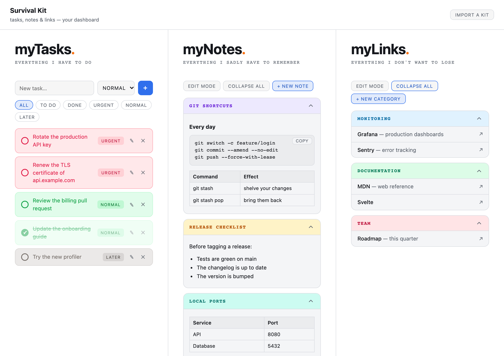
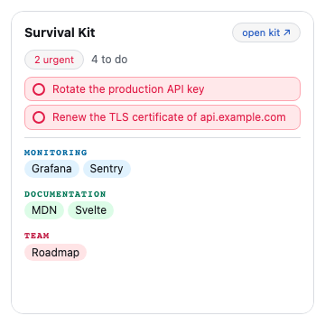
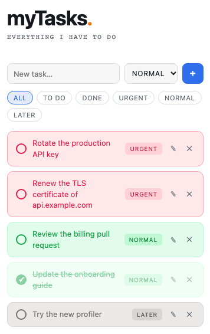
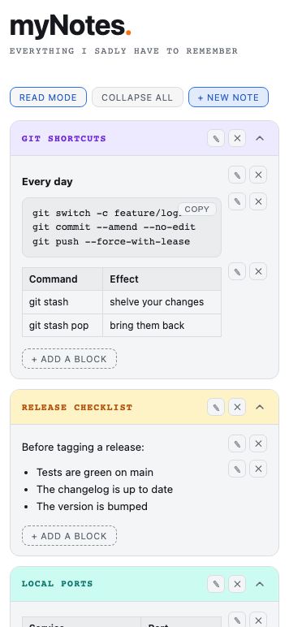
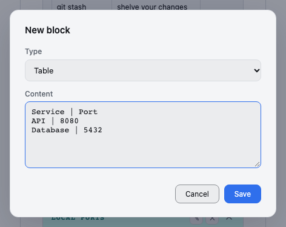
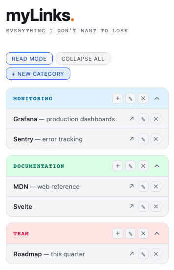
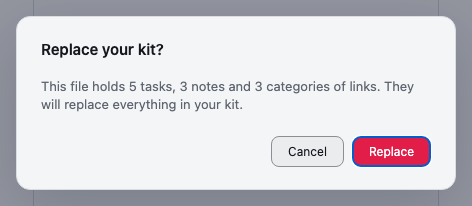

# Survival Kit

**Your tasks, notes and links on one screen: everything you have to do, remember and not lose.**

The Survival Kit is a small dashboard for your working day. Three panels sit side by side:

- **myTasks**: everything you have to do, sorted by priority;
- **myNotes**: everything you sadly have to remember, such as commands, checklists and tables;
- **myLinks**: everything you don't want to lose, as bookmarks grouped in colored categories.

Every change is saved the moment you make it. There is no Save button.



## Contents

- [Getting started](#getting-started)
- [On the Home: the Widget](#on-the-home-the-widget)
- [myTasks](#mytasks)
- [myNotes](#mynotes)
- [myLinks](#mylinks)
- [Bring your kit from living-documentation](#bring-your-kit-from-living-documentation)
- [Your data](#your-data)
- [Looks and language](#looks-and-language)
- [When something goes wrong](#when-something-goes-wrong)
- [Tips and shortcuts](#tips-and-shortcuts)

## Getting started

Open **Survival Kit** from the Launcher, on the left of Tessello. The kit starts empty:

1. Type your first task in **New task…** and press **Enter**.
2. Click **+ new note** to keep something you need to remember.
3. Click **+ new category** to start a group of links.

On a narrow window, the three panels are stacked as cards, in the order tasks, notes, links.

## On the Home: the Widget

The Survival Kit puts a large Widget on your Home. It is a summary of the kit that you can use without opening it.



- **N urgent** counts the urgent tasks still to do. Click it to open the kit with only the **Urgent** tasks shown.
- **N to do** counts every task not done yet.
- Below the counts are your **urgent tasks**. Click the circle in front of one to mark it as done: it leaves the Widget, and the kit shows it as done the next time you open it.
- Your **links** come next, grouped by category. Click one to open it in a new tab.
- **open kit ↗** opens the whole kit.

The Widget never scrolls. When you have many links, the last ones are cut off: open the kit to see them all.

## myTasks



### Add a task

Type the task in **New task…**, choose its priority, then press **Enter** or click **+**. The new task goes to the top of the list. The priority you chose stays selected for the next task, which makes it quick to add several urgent tasks in a row.

There are three priorities, each with its own color:

| Priority | Color | Use it for |
|---|---|---|
| **Urgent** | red | what cannot wait |
| **Normal** | green | the rest of your day |
| **Later** | gray | ideas and "some day" |

### Check, change and delete a task

- Click the **circle** in front of a task to mark it as done. The task fades and is struck through. Click again to bring it back.
- Click **✎** to change the task's text or its priority, then **Save**.
- Click **✕** to delete the task. The kit asks you to confirm, because a deleted task cannot be brought back.

### Filter the list

The buttons above the list show only some of your tasks:

| Filter | Shows |
|---|---|
| **All** | every task |
| **To do** | the tasks not done yet |
| **Done** | the tasks done |
| **Urgent**, **Normal**, **Later** | the tasks of that priority, done or not |

The kit always opens on **All**, unless you opened it from the Widget's urgent count.

## myNotes

A note is a colored card with a title and a list of **blocks**: headings, text, code, bullet lists and tables.

### Create a note

Click **+ new note**, type a title (for example "Git shortcuts"), pick one of the six colors and click **Create**. The note is added at the end of the list and opens straight away.

### Read mode and edit mode

The panel opens in **read mode**, which keeps your notes clean. Click **edit mode** to show the buttons that change them:



- On a note: **✎** changes its title or color, and **✕** deletes it with all its blocks.
- On a block: **✎** changes it, including its type, and **✕** deletes it.
- **+ add a block**, at the end of each open note, adds a block.

Click **read mode** to hide the buttons again. myNotes and myLinks each have their own mode.

### The five kinds of block



| Block | What you type | What you get |
|---|---|---|
| **Heading** | one line | a bold line that starts a section of the note |
| **Text** | a paragraph; line breaks are kept | a paragraph |
| **Code** | anything; spaces and line breaks are kept exactly | a monospace block with a **copy** button |
| **Bullet list** | one item per line | a bulleted list; empty lines are skipped |
| **Table** | one row per line, cells separated by `\|` | a table whose first line gives the column headers |

For example, this Table block:

```
Command | Effect
git stash | shelve your changes
git stash pop | bring them back
```

gives a two-column table headed "Command" and "Effect".

### Copy a Code block

Click **copy** on a Code block. The button reads **copied ✓** for a moment, and the code is on your clipboard.

If your browser does not let the kit use the clipboard, the button reads **selected: press Ctrl+C** instead. The code is selected for you: press **Ctrl**+**C** (**⌘**+**C** on a Mac) to copy it.

### Open and close notes

Click the chevron **⌃** of a note to open or close it, or use **expand all** and **collapse all** for every note at once. Every note is closed when the kit opens.

## myLinks

Links are grouped in **categories**, each with a name and a color, such as "Monitoring" or "Documentation".



### Create a category and add links

1. Click **+ new category**, type its name, pick a color and click **Add**.
2. Click **edit mode**, then **＋** on the category.
3. Fill in the link's **Name** (for example "Grafana"), an optional **Description** ("production dashboards") and its **URL**, then click **Add**.

You can type a URL without `https://`: `grafana.example.com` is saved as `https://grafana.example.com`. Addresses starting with `http://`, `https://`, `mailto:` or `tel:` are kept as they are.

### Open, change and delete links

- Open a category with its chevron, then click a link to open it in a **new tab**. Tessello stays where it was.
- In edit mode, **✎** on a link changes it, and **✕** deletes it. These buttons never open the link.
- In edit mode, **✎** on a category changes its name or color, and **✕** deletes it with all its links.

Every deletion asks you to confirm first.

Categories are closed when the kit opens, and a new category starts closed too. Two categories with the same name open and close together, so give each category its own name.

## Bring your kit from living-documentation

If you used the Survival Kit of living-documentation, you can bring everything over. Its kit is the file `.survival-kit.json`, in your documentation folder.

1. Click **Import a kit**, at the top right of the kit.
2. Choose the `.survival-kit.json` file.
3. The kit tells you what the file holds, then asks you to confirm.



> **An import replaces your whole kit.** The tasks, notes and links you have now are deleted, not merged. Import before you start, or keep a copy of your Modules folder.

A file that is not a Survival Kit is refused, and your kit stays as it was. Parts the kit cannot read are skipped. For example, a link without a URL is left out, and an unknown color becomes green.

## Your data

- **Where it is.** Your kit is kept in your **Modules folder**, on your computer, in `.tessello/data/@craftskillz/survival-kit/`. There is one file for each panel: `tasks.json`, `notes.json` and `links.json`. Nothing is sent anywhere: the Survival Kit asks for no Permission and cannot reach the network.
- **The View and the Widget share it.** A task checked in the Widget is done in the kit, and the other way round. Each one reads the kit again whenever it comes back on screen.
- **Saving.** Every change is saved at once. If a change cannot be saved, the kit tells you (see below).
- **Backups and history.** Your Modules folder is an ordinary folder, so you can back it up or version it with git to keep the history of your kit. If your notes hold secrets, such as tokens or passwords, keep `.tessello/data/` out of anything you share.
- **Your kit is yours.** Unlike the original Survival Kit, which lived in a shared documentation folder, this kit belongs to your Modules folder only. Another computer has its own kit.
- **Limits.** Tessello gives each panel up to 1 MB and the whole kit up to 5 MB. That is a lot of text: thousands of tasks, notes or links.
- **Updates keep your kit.** Installing a new version of the Survival Kit keeps everything, including a kit saved by version 1.0.0.
- **Uninstalling deletes your kit.** Uninstalling the Survival Kit from Tessello (ⓘ, then **Uninstall…**) deletes its data for good. Export it first by keeping a copy of the three files above.

## Looks and language

- **Theme.** The kit follows Tessello's light or dark theme. The six colors of notes and categories (Green, Violet, Amber, Sky, Rose, Teal) each have a light and a dark version.
- **Language.** The kit speaks English, or French when Tessello is in French. Your own tasks, notes and links are never translated.

## When something goes wrong

| You see | What it means | What to do |
|---|---|---|
| *Your kit could not be read (…). Nothing can be changed until it is read, so that nothing is lost.* | Tessello could not read the kit from your Modules folder. The kit blocks every change, so that an empty kit on screen never replaces your real one. | Click **Try again**. If it keeps failing, check that your Modules folder is still there and that the browser can still use it. |
| *Your last change could not be saved (…). It will be lost when you leave.* | Writing to your Modules folder failed. Your change is still on screen, but not saved. | Make sure the Modules folder is reachable, then make any change again. If that change is saved, everything shown is saved. |
| *Your last change could not be saved: the storage of the Survival Kit is full.* | A panel has passed 1 MB, or the kit 5 MB. A very long Code block is usually the reason. | Delete or shorten a big note, then make your change again. |
| *… can't be imported: it is not a Survival Kit.* | The file you chose is not JSON, or holds no tasks, notes or links. | Choose the `.survival-kit.json` file of your documentation folder. |
| *The kit could not be read.* (in the Widget) | The Widget could not read the kit. | Open the kit from the Launcher to see why. |
| *selected: press Ctrl+C* | The browser does not let the kit copy for you. | The code is selected: copy it with the keyboard. |
| A dialog does not close when you confirm | A required field is empty: a task's text, a note's title, a block's content, or a link's name or URL. | Fill it in, or click **Cancel**. |
| *Survival Kit is not responding* (shown by Tessello) | The kit did not finish starting. | Reload Tessello. If it persists, install the Survival Kit again: your kit is kept. |

## Tips and shortcuts

- **Enter** adds a task, and confirms the dialogs of a note, a category, a heading block and a link URL.
- **Escape**, or a click outside a dialog, closes it without saving.
- Keep **Urgent** for what really is urgent: those are the tasks the Widget puts in front of you on the Home.
- A note with a **Code** block of your most used commands, and a **Table** of your local ports, saves many searches.
- Nothing can be reordered yet. New tasks go to the top, and new notes, blocks, categories and links go to the end.
